# Manual do Usuário

**Versão 1.0**

**CARREGAJA - Sistema de Controle e Rateio de Recarga de Veículos Elétricos em Condomínio**

## Histórico de Revisões

| Data | Versão | Descrição | Autor |
|---|---|---|---|
| 23/11/2026 | 1.0 | Criação do manual da versão v-4.0.0, com as funções do morador e do síndico e as telas, capturadas na versão com as correções do sprint 7. | Henrique de Almeida Marangoni Inacio |

## 1. Introdução

O CARREGAJA organiza o uso das vagas com carregador de veículo elétrico do condomínio e divide a
conta da energia entre os apartamentos, pelo que cada um carregou.

Com ele, o **morador** vê pelo celular quais vagas estão livres, registra o início e o fim de cada
recarga e acompanha quanto o apartamento consumiu no mês. O **síndico** cadastra moradores, vagas e
a tarifa, encerra recargas esquecidas abertas e, no fim do mês, gera o rateio que vai para a
administradora lançar na cota condominial.

O sistema não se liga aos carregadores: ele registra o que as pessoas informam. A energia de cada
recarga é **estimada** pela potência, pelo tempo e pela carga que faltava na bateria (seção 4.1.3).

**Como acessar.** Abra no navegador do celular ou do computador o endereço que o síndico informar
(por exemplo, `https://carregaja.onrender.com`). Não é preciso instalar nada. As telas usadas neste
manual mostram dados de exemplo.

## 2. Como Está Organizado o Manual

| Seção | Para quem | O que tem |
|---|---|---|
| 3. Funcionalidades gerais | Todos | Entrar, primeiro acesso, troca de senha, menu, mensagens e cores das situações |
| 4.1. Morador | Quem mora no condomínio | Painel, veículo, recarga e consumo do mês |
| 4.2. Síndico | Síndico e preposto da administradora | Moradores, vagas, tarifa, sessões abertas, fechamento do mês e histórico |
| 5. Glossário | Todos | Os termos que aparecem nas telas |

Cada função traz **para que serve**, **o passo a passo**, a **tela** e as **recusas** que podem
aparecer, com o motivo. O síndico que também mora no condomínio usa as duas partes da seção 4.

## 3. Funcionalidades Gerais do Sistema

### 3.1. Entrar

1. Abra o endereço do sistema. A tela de entrada aparece.
2. Informe o **e-mail** e a **senha** e toque em **Entrar**.
3. Você vai para o **Painel de vagas**.

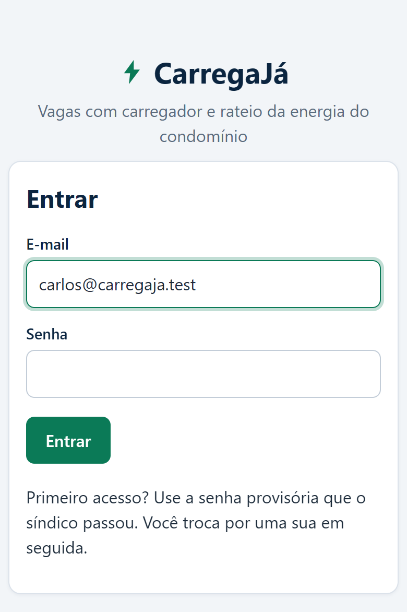

*Figura 1: tela de entrada.*

Se aparecer **"E-mail ou senha incorretos."**, confira os dois: por segurança, o sistema não diz qual
está errado. Se aparecer **"Seu acesso está desativado. Procure o síndico."**, o síndico desativou o
seu cadastro.

### 3.2. Primeiro acesso e troca de senha

No cadastro, o síndico define uma **senha provisória** e a passa a você. No primeiro acesso, o sistema
leva direto à tela **Trocar senha**, e nenhuma outra função abre até a troca.

1. Em **Senha atual**, informe a senha provisória.
2. Em **Senha nova**, escolha uma senha de 8 a 72 caracteres, e repita-a no campo seguinte.
3. Toque em **Trocar senha**. O painel abre.

*Figura 2: troca da senha provisória.*

Para trocar a senha depois, use **Trocar senha**, no topo de qualquer tela. **Ao trocar a senha, os
acessos abertos com a senha antiga em outros aparelhos deixam de valer**, e eles voltam à tela de
entrada.

**Esqueceu a senha?** Peça ao síndico uma nova senha provisória (seção 4.2.2). No acesso seguinte, você
a troca por uma sua.

### 3.3. Menu

O topo de cada tela tem a marca **CarregaJá**, o seu nome (em telas maiores), **Trocar senha** e **Sair**. Abaixo fica o
menu, só com o que o seu perfil usa:

- **Painel:** todos.
- **Morador:** Recarga, Veículo e Consumo.
- **Síndico:** Sessões, Vagas, Moradores, Tarifa, Fechamento e Histórico.

A página aberta fica destacada no menu. Toque em **Sair** ao usar um aparelho que não é seu.

No celular, as tabelas largas rolam para o lado dentro da tela: arraste a tabela para ver as últimas
colunas.

### 3.4. Mensagens

Depois de cada ação, uma faixa no alto da tela diz o que aconteceu:

- **verde:** a ação foi feita (ex.: "Veículo salvo.");
- **vermelha:** a ação foi recusada, e a mensagem diz o motivo e o que fazer (ex.: "A vaga G-03 está
  ocupada. Previsão de liberação: 03:12.").

### 3.5. Situações das vagas

| Situação | Cor | Significado |
|---|---|---|
| Livre | Verde | Pode ser usada |
| Ocupada / Carregando | Azul | Há uma recarga dentro do tempo previsto |
| Carga concluída, vaga ainda ocupada | Amarela | A carga já deve ter terminado, mas a recarga não foi encerrada |
| Excedida (passou da duração máxima) | Vermelha | A recarga passou de 6 horas. Ela continua aberta: o morador deve tirar o veículo e encerrar |

### 3.6. Sistema demorando a abrir

Se ninguém usar o sistema por algum tempo, a primeira abertura pode levar até uns 3 minutos, porque o
servidor estava em repouso. Não é defeito: espere e recarregue a página. Depois disso, ele responde
normalmente.

## 4. Funcionalidades do Sistema

### 4.1. Morador

#### 4.1.1. Painel de vagas

**Para que serve:** ver, antes de descer à garagem, quais vagas estão livres e quando as ocupadas devem
liberar.

A tela mostra cada vaga com a **potência** do carregador, a **situação** e, nas ocupadas, a hora em que
devem liberar (**Libera por volta de**). Quem ocupa a vaga não aparece para o morador. Toque em
**Atualizar** para ver a situação mais recente.

Quando não há vaga livre, o painel avisa e mostra a **liberação mais próxima**, contando só as vagas que
ainda estão dentro do tempo previsto.

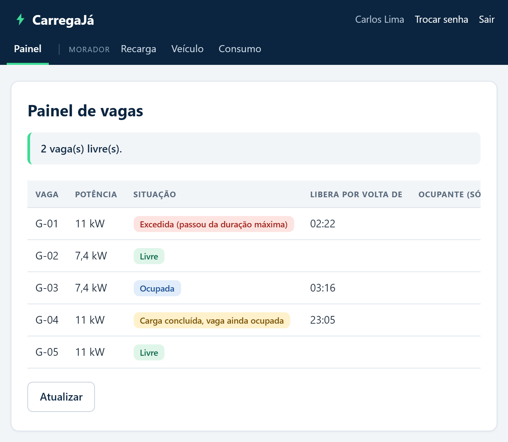

*Figura 3: painel de vagas, como o morador vê.*

#### 4.1.2. Cadastrar o veículo

**Para que serve:** o sistema usa os dados do veículo para calcular a potência da recarga e a energia
que falta. Cadastre uma vez; nas recargas, não é preciso digitar de novo.

1. No menu, toque em **Veículo**.
2. Informe o **modelo**, a **capacidade da bateria** (kWh) e a **potência máxima de carga** (kW). Os dois
   números estão no manual do veículo e precisam ser maiores que zero.
3. Toque em **Salvar**. Aparece "Veículo salvo."

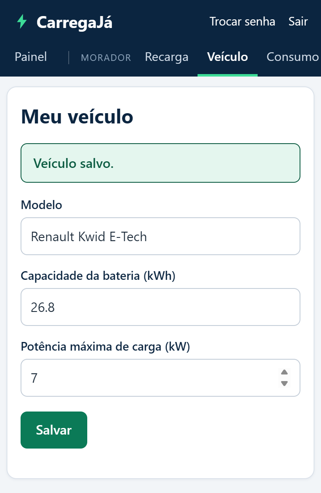

*Figura 4: cadastro do veículo.*

Para trocar de veículo, abra a mesma tela, altere os dados e salve. As recargas já feitas não mudam de
energia nem de valor. Cada morador tem um veículo cadastrado.

Se você tentar iniciar uma recarga sem veículo, a tela avisa e traz o link **Cadastrar meu veículo**:

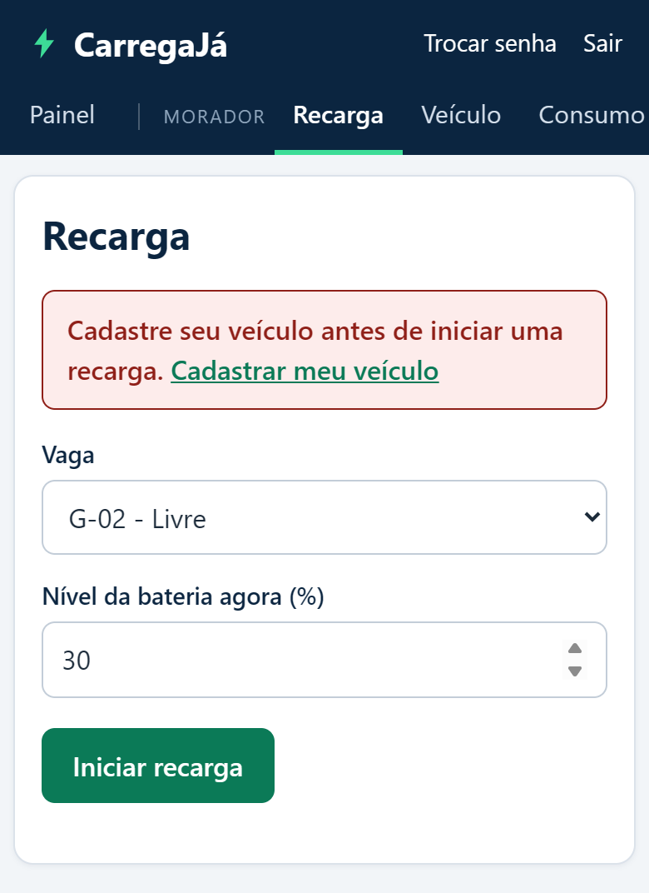

*Figura 5: recarga recusada por falta de veículo, com o caminho para o cadastro.*

#### 4.1.3. Iniciar a recarga

**Para que serve:** registrar que você ocupou a vaga e começou a carregar. A partir daí a vaga aparece
ocupada no painel, com a previsão de término.

1. Estacione numa vaga livre e ligue o carregador.
2. No menu, toque em **Recarga**.
3. Escolha a **vaga** e informe o **nível da bateria agora** (%), como aparece no painel do veículo.
4. Toque em **Iniciar recarga**.

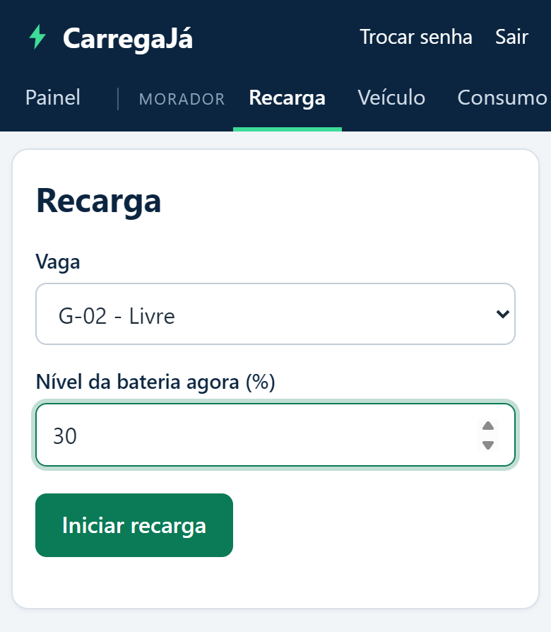

*Figura 6: início da recarga.*

A tela passa a mostrar a recarga aberta: o veículo, a hora do início, a **previsão de término**, a
**potência efetiva**, a **energia a repor** e a **tarifa** do kWh.

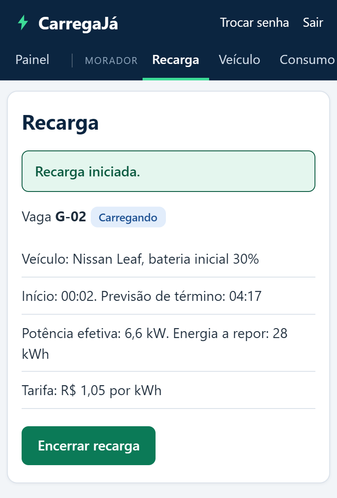

*Figura 7: recarga em andamento.*

**Como o sistema calcula.** A **potência efetiva** é a menor entre a do carregador da vaga e a máxima do
seu veículo: um carregador maior não acelera um veículo que carrega mais devagar. A **energia a repor**
é o que falta na bateria: capacidade × (100% − nível informado). A **previsão de término** é o tempo
para repor essa energia na potência efetiva.

*Exemplo:* Nissan Leaf (40 kWh, até 6,6 kW) na vaga G-02 (7,4 kW), com a bateria em 30%. Potência
efetiva: 6,6 kW. Energia a repor: 40 × 70% = 28 kWh. Previsão: 28 ÷ 6,6 = 4h15 depois do início.

**Recusas possíveis:**

| Mensagem | O que fazer |
|---|---|
| "A vaga G-03 está ocupada. Previsão de liberação: ..." | Escolha outra vaga. A tentativa fica registrada para o síndico ver a procura por vagas |
| "A vaga G-09 está desativada." | A vaga está fora de uso; escolha outra |
| "Você já tem uma sessão de recarga aberta." | Encerre a recarga anterior antes |
| "Cadastre seu veículo antes de iniciar uma recarga." | Use o link para cadastrar o veículo (seção 4.1.2) |
| "A bateria já está cheia: não há recarga a fazer." | Com 100%, não há o que carregar |

**Duração máxima:** uma recarga pode ficar aberta por até **6 horas**. Depois disso ela aparece como
**Excedida** no painel, para os outros moradores e o síndico saberem que a vaga deveria estar livre. O
sistema não a encerra sozinho.

#### 4.1.4. Encerrar a recarga

**Para que serve:** registrar que você tirou o veículo, liberar a vaga e apurar a energia e o valor.

1. Desligue o carregador e tire o veículo.
2. No menu, toque em **Recarga** e em **Encerrar recarga**. Confirme.
3. A tela mostra a **duração**, a **energia** e o **valor** da recarga, e a vaga volta a ficar livre.

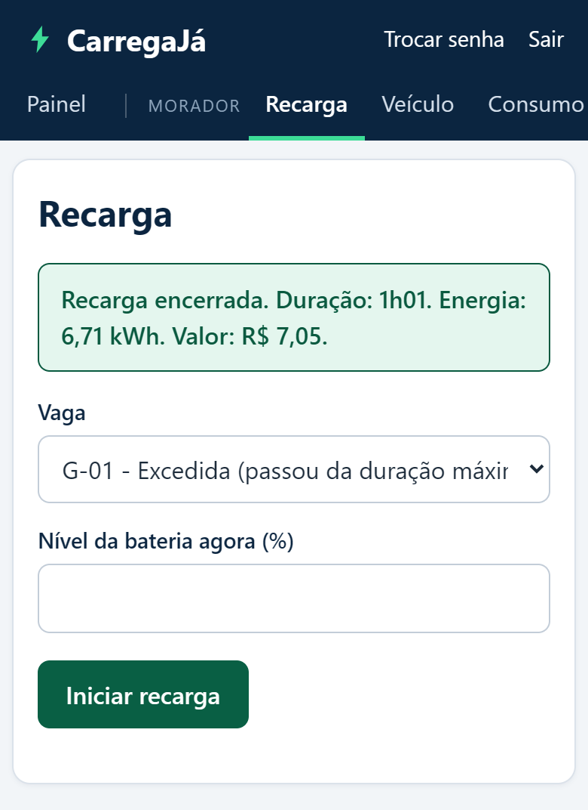

*Figura 8: recarga encerrada, com duração, energia e valor.*

**Como o valor é apurado.** Energia = potência efetiva × duração (em minutos inteiros), limitada à
energia a repor: ficar mais tempo na vaga depois de carregado não aumenta a energia. Valor = energia ×
tarifa do kWh **vigente no início** da recarga; se o síndico mudar a tarifa durante a sua recarga, ela
segue a do início.

*Exemplo da figura 8:* 1h01 são 61 minutos; a 6,6 kW, 6,6 × 61 ÷ 60 = 6,71 kWh; a R$ 1,05 o kWh, R$ 7,05.

Encerre sempre que sair da vaga. Se você esquecer, o síndico pode encerrar a recarga por você depois da
previsão de término (seção 4.2.5), e ela aparece no seu consumo como **Encerrada pelo síndico**.

#### 4.1.5. Consumo do mês

**Para que serve:** acompanhar quanto o seu apartamento carregou e quanto vai pagar no rateio.

1. No menu, toque em **Consumo**.
2. Escolha o **mês**.

A tela mostra o total de energia e o valor do **apartamento** no mês, somando as recargas de todos os
moradores dele, e cada recarga com a vaga, o início, o fim, a energia e o valor. As recargas que o
síndico encerrou aparecem marcadas. Sem recargas no mês, aparece "Não há consumo registrado no mês."

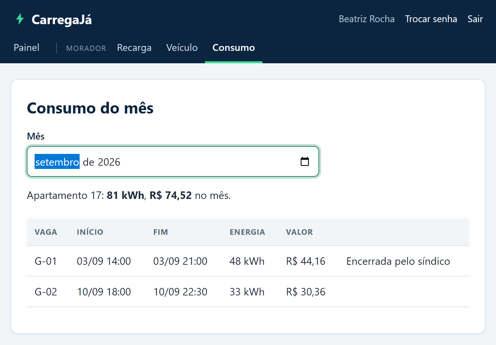

*Figura 9: consumo do mês, com uma recarga encerrada pelo síndico.*

O consumo é só do seu apartamento: o dos outros não aparece. As recargas contam no mês em que
**começaram**.

### 4.2. Síndico

#### 4.2.1. Painel de vagas do síndico

O síndico vê o mesmo painel do morador (seção 4.1.1) e, nas vagas ocupadas, também o **apartamento e
o nome** de quem ocupa (coluna **Ocupante**). É o ponto de partida para cobrar quem passou do tempo.

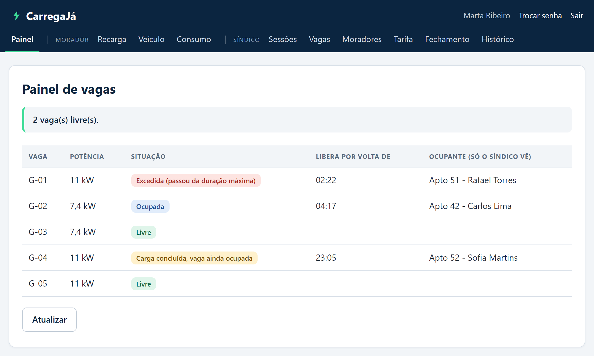

*Figura 10: painel de vagas, como o síndico vê.*

#### 4.2.2. Moradores

**Para que serve:** dar e tirar acesso ao sistema. Cada morador fica ligado a um apartamento, que é a
unidade do rateio.

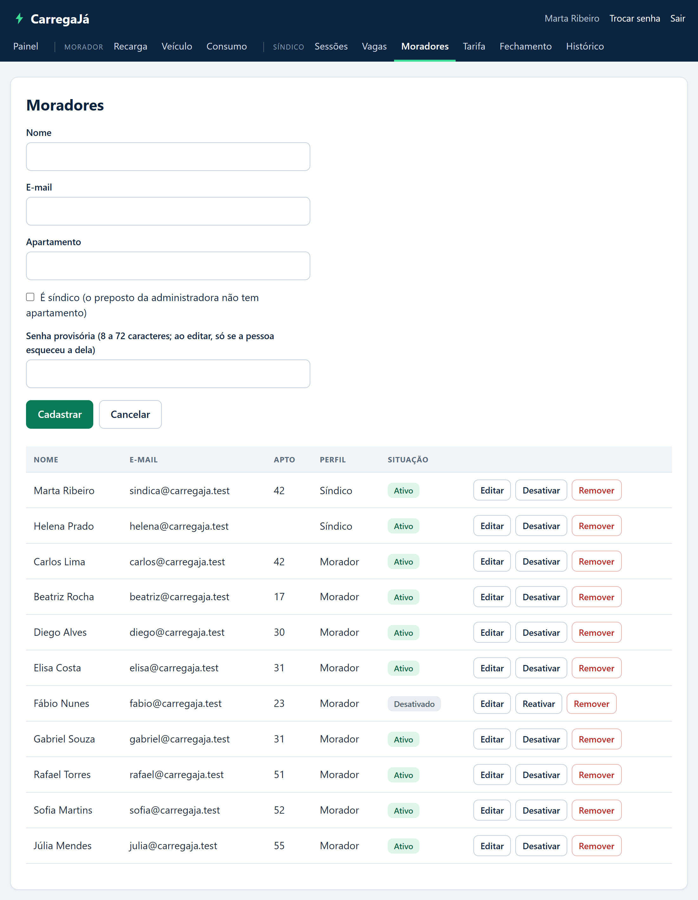

*Figura 11: moradores e síndicos cadastrados.*

**Cadastrar:**

1. No menu, toque em **Moradores**.
2. Informe **nome**, **e-mail** e **apartamento**. Marque **É síndico** para quem vai administrar o
   sistema; o preposto da administradora é síndico sem apartamento.
3. Defina uma **senha provisória** (8 a 72 caracteres) e toque em **Cadastrar**.
4. Passe ao morador o endereço do sistema, o e-mail e a senha provisória. No primeiro acesso, ele a
   troca (seção 3.2).

Mais de um morador pode ter o mesmo apartamento: o consumo e o rateio somam as recargas de todos.

**Na lista**, cada pessoa tem:

| Botão | O que faz |
|---|---|
| **Editar** | Traz os dados para o formulário. Para quem esqueceu a senha, informe uma nova senha provisória e salve: ela vale no próximo acesso, e os acessos abertos com a senha antiga deixam de valer |
| **Desativar** | Tira o acesso na hora, mantendo o cadastro e as recargas. Use para quem se mudou. **Reativar** devolve o acesso |
| **Remover** | Apaga o cadastro. Só funciona para quem nunca usou as vagas |

**Recusas possíveis:**

| Mensagem | Motivo |
|---|---|
| "Este e-mail já está cadastrado." | Cada pessoa tem um e-mail diferente (maiúsculas não contam) |
| "Este morador tem sessões registradas: desative-o em vez de remover." | O histórico de recargas precisa ser mantido para o rateio |
| "Este morador tem sessões registradas: o apartamento não pode ser trocado nem retirado..." | Mudar o apartamento levaria as recargas passadas junto. Se ele se mudou de apartamento, desative-o e faça um cadastro novo, com outro e-mail |
| "O condomínio ficaria sem síndico. Cadastre outro antes." | Precisa haver sempre um síndico ativo |

#### 4.2.3. Vagas

**Para que serve:** manter a lista de vagas com carregador e a potência de cada uma, usada no cálculo da
recarga.

1. No menu, toque em **Vagas**.
2. Informe a **identificação** (ex.: G-01) e a **potência do carregador** (kW), e toque em **Cadastrar**.

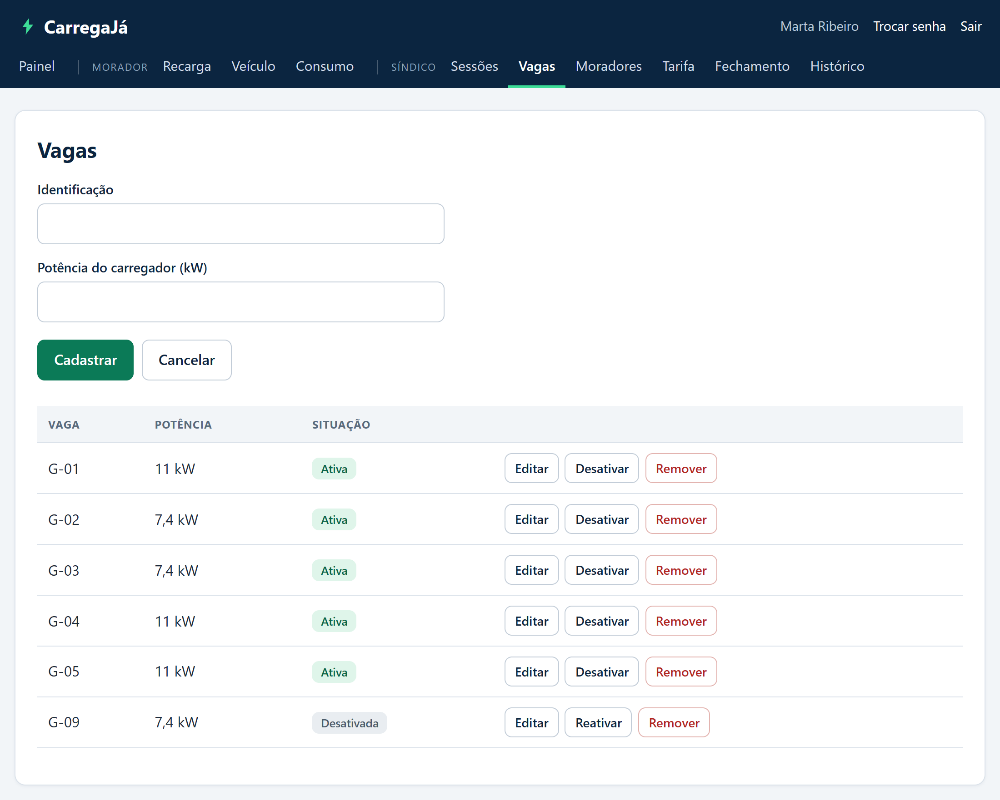

*Figura 12: vagas com carregador.*

**Editar** altera a identificação ou a potência. **Desativar** tira a vaga do painel e impede novas
recargas, por exemplo durante um conserto, mantendo o histórico; **Reativar** a devolve. **Remover** só
funciona para vaga que nunca foi usada; nas outras, desative. Não pode haver duas vagas com a mesma
identificação (G-01 e g-01 são a mesma).

#### 4.2.4. Tarifa do kWh

**Para que serve:** definir quanto custa o kWh no rateio, normalmente o valor da conta de luz do
condomínio.

1. No menu, toque em **Tarifa**.
2. Informe o **novo valor do kWh** (R$) e toque em **Cadastrar tarifa**.

A tarifa vale **a partir do momento do cadastro** até o cadastro da próxima. Ela não vale para trás: as
recargas que já começaram seguem a tarifa do início. A lista abaixo mostra todas as tarifas, desde
quando valeram e quem as cadastrou.

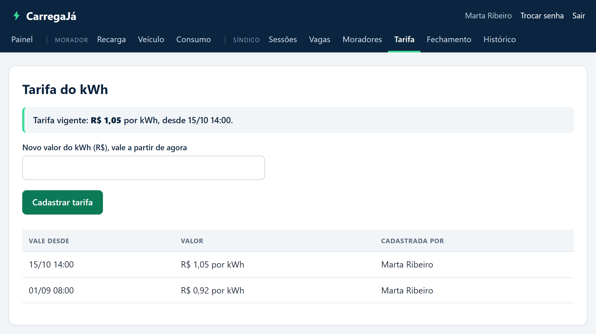

*Figura 13: tarifa do kWh e o histórico de tarifas.*

#### 4.2.5. Sessões abertas (recarga esquecida)

**Para que serve:** encerrar a recarga de quem tirou o veículo e esqueceu de encerrar, para liberar a vaga
no painel e apurar a recarga.

1. No menu, toque em **Sessões**. A tela lista as recargas abertas, das mais antigas às mais novas.
2. **Vá à garagem e confira que o veículo saiu.**
3. Toque em **Encerrar** na recarga e confirme que viu a vaga vazia.

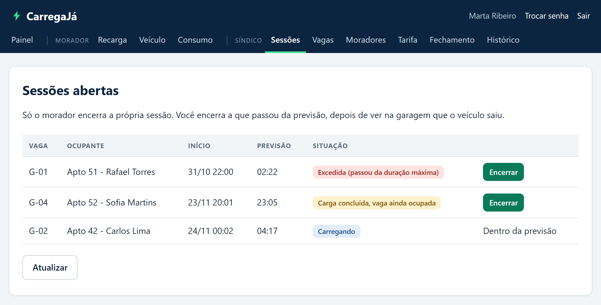

*Figura 14: sessões abertas; a que está dentro da previsão não pode ser encerrada pelo síndico.*

O botão só aparece depois da **previsão de término**: antes disso, a recarga está **Dentro da previsão**
e só o morador a encerra. O encerramento fica registrado com o seu nome e a hora, e o morador o vê no
consumo. A energia é limitada ao que faltava na bateria, então uma recarga esquecida por dias não gera
um valor fora da realidade.

#### 4.2.6. Fechamento do mês

**Para que serve:** gerar o rateio do mês por apartamento, para a administradora lançar na cota
condominial.

1. No menu, toque em **Fechamento**.
2. Escolha o **mês a fechar** e toque em **Fechar o mês**. Confirme.
3. A tela mostra o **rateio**: energia e valor de cada apartamento e o total do condomínio, com a hora e
   o seu nome.
4. Toque em **Exportar CSV** para baixar o arquivo e enviá-lo à administradora. Ele abre no Excel.

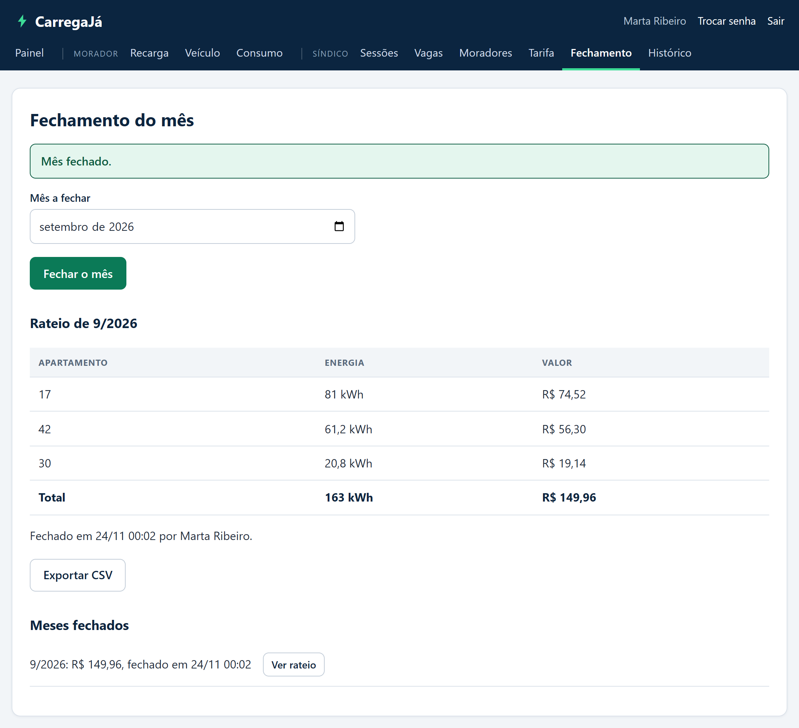

*Figura 15: rateio do mês fechado.*

Em **Meses fechados**, **Ver rateio** mostra de novo o rateio de um mês já fechado.

**Recusas possíveis:**

| Mensagem | O que fazer |
|---|---|
| "O mês ainda não terminou." | Feche depois do último dia do mês |
| "Há sessões em aberto no mês: vaga G-01, apto 51, início ..." | Peça ao morador que encerre, ou encerre pela tela de sessões abertas (seção 4.2.5), e feche de novo |
| "Este mês já foi fechado." | Cada mês é fechado uma vez só e não é recalculado. Use **Ver rateio** |
| "Não há sessão encerrada no mês: não há rateio a fazer." | Não houve recarga no mês |

#### 4.2.7. Histórico de utilização

**Para que serve:** ver se as vagas dão conta da procura, para decidir, por exemplo, se vale instalar mais
um carregador.

1. No menu, toque em **Histórico**.
2. Informe o período (**De** e **Até**) e toque em **Consultar**.

A tela mostra o **horário de pico** e o número de **recusas por falta de vaga**, e as tabelas de
**ocupação por vaga** (horas e % do período), **uso por hora do dia**, **consumo por apartamento** e
**recusas por vaga ocupada**. Muitas recusas no horário de pico indicam que faltam vagas.

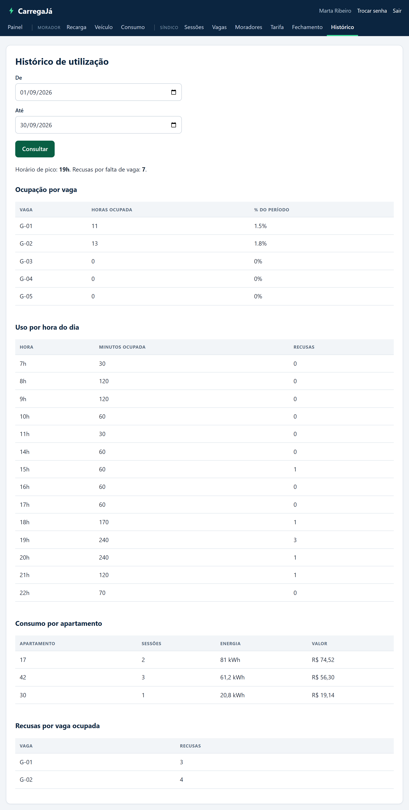

*Figura 16: histórico de utilização de um mês.*

## 5. Glossário

| Termo/Sigla | Descrição |
|---|---|
| kW (quilowatt) | Potência: a rapidez com que o carregador ou o veículo recebe energia |
| kWh (quilowatt-hora) | Energia: 1 kWh é o que entra em 1 hora a 1 kW. É a unidade da conta de luz |
| Capacidade da bateria | Quanta energia a bateria do veículo guarda cheia, em kWh |
| Potência do carregador | A potência que o carregador da vaga entrega, em kW |
| Potência máxima de carga | A maior potência que o veículo aceita, em kW |
| Potência efetiva | A menor entre a do carregador e a do veículo: a que vale na recarga |
| Energia a repor | O que falta na bateria: capacidade × (100% − nível informado) |
| Energia (estimada) | A energia apurada no encerramento: potência efetiva × duração, até a energia a repor |
| Previsão de término | Hora em que a energia a repor termina de entrar, na potência efetiva |
| Duração máxima | 6 horas. Passado esse tempo, a recarga aparece como Excedida |
| Sessão (de recarga) | Uma recarga, do início ao encerramento |
| Sessão aberta | Recarga iniciada e ainda não encerrada |
| Encerrada pelo síndico | Recarga que o síndico encerrou porque o morador esqueceu |
| Recusa por vaga ocupada | Tentativa de iniciar numa vaga ocupada. Conta como procura não atendida no histórico |
| Tarifa | Preço do kWh, vigente do cadastro até a próxima tarifa |
| Fechamento do mês | Apuração final do mês, que não muda depois de feita |
| Rateio | A divisão do valor da energia entre os apartamentos, pelo que cada um carregou |
| CSV | Arquivo de planilha simples, que o Excel abre, com o rateio do mês |
| Senha provisória | Senha definida pelo síndico, válida só até o morador trocá-la no primeiro acesso |
| Desativar | Tirar o acesso de alguém ou tirar uma vaga de uso, mantendo o histórico |
| Preposto da administradora | Representante da administradora que atua como síndico sem morar no condomínio |
